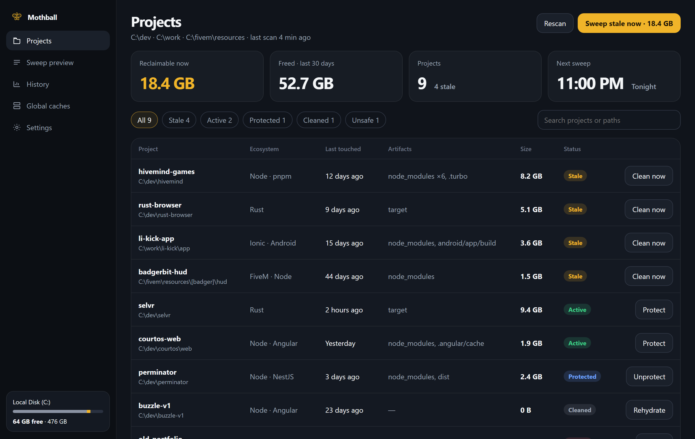
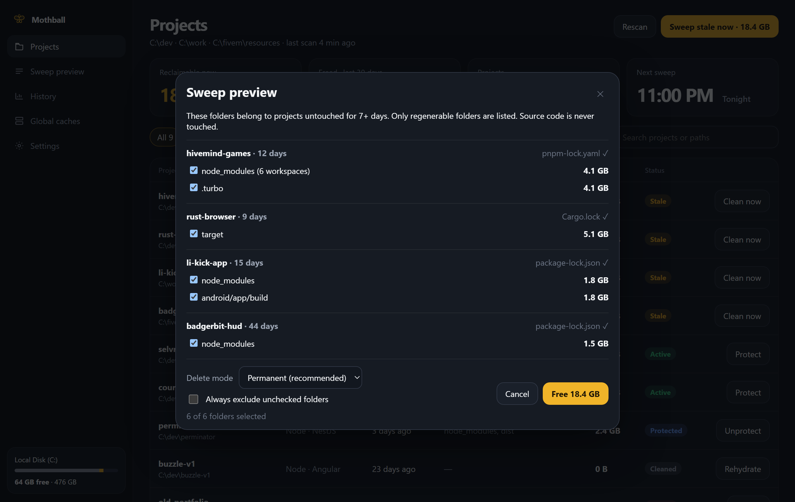
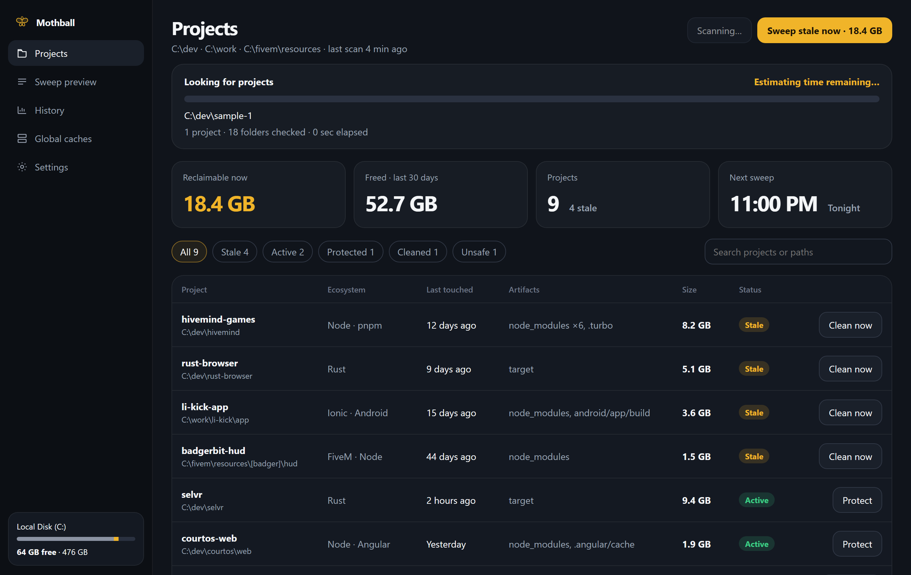
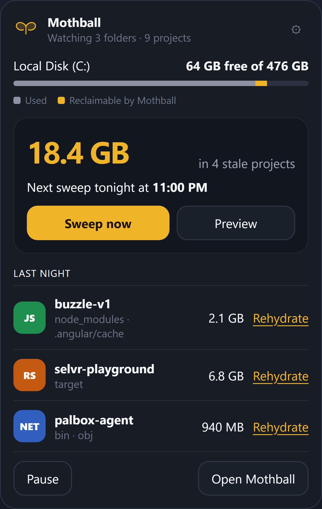
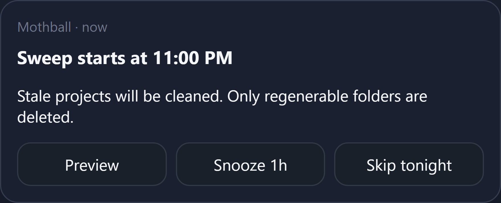
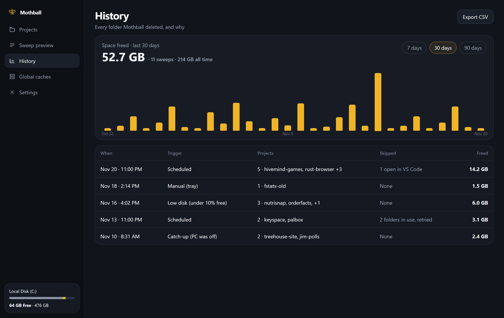
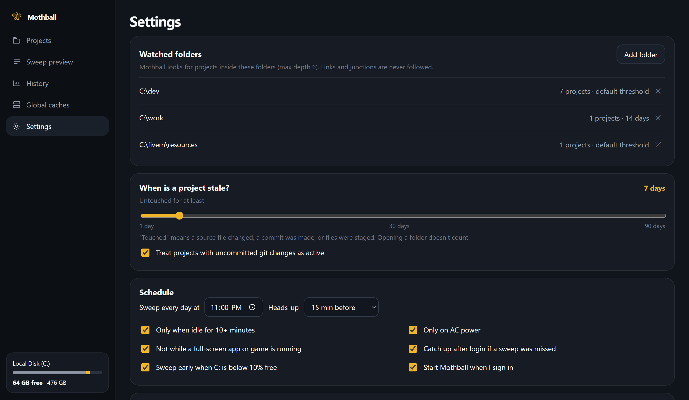
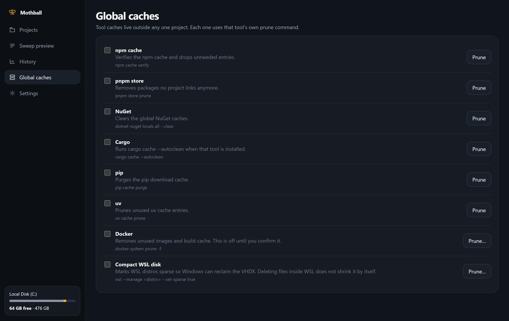

# Mothball

Mothball finds dev projects you have not touched in a while and deletes only the folders a lockfile can rebuild: `node_modules`, `target`, `bin/obj`, caches, and the rest. Source code stays. Bringing a project back is one click.

It runs from the system tray, sweeps on a schedule when you are idle, and keeps a local history of everything it removed. Nothing leaves the machine.



The screenshots use the sample dashboard that ships with the interface.

## What it will delete

A project is a folder with a marker such as `package.json`, `Cargo.toml`, or a `.csproj`. Nested workspaces stay inside the outermost project. Mothball only deletes folders that match a rule for that ecosystem.

| | |
| --- | --- |
| Node, Rust, .NET, Python, Go | on by default |
| Gradle, Maven, Android, Flutter, iOS, Ionic, Terraform, FiveM | on by default |
| PHP / Composer, Unity | off until you turn them on |
| `dist`, `build`, `out`, `.venv`, `vendor` | off until you opt in |

Without a lockfile the project is marked unsafe and skipped. Projects that are open in an editor, or that have a file in use, are skipped too. A protected project, or a `.mothball` file with `protect = true`, is never cleaned. Symlinks and junctions are unlinked, not followed, so a pnpm store outside the repo is left alone.

## Sweep

The first look at a clean is a preview. Uncheck anything you want to keep, then confirm. Permanent delete is the default, because the Recycle Bin does not free this kind of space. You can switch a sweep to the Recycle Bin.



While a clean is running, the dialog shows the current folder, how many files have been removed, how much space is freed, and a time remaining. **Stop** halts the delete.

A scan has the same kind of progress: folders checked while it is searching, then a bar and an estimate while it measures sizes.



## Tray

Closing the window leaves Mothball running. Left-click the tray icon for the popover. Right-click for Sweep, Preview, Rescan, Pause, and Quit.

| Tray | Before a sweep |
| --- | --- |
|  |  |

The nightly sweep waits until you are idle, on AC power, and not in a full-screen app. If the PC was off, it catches up after the next login. A heads-up can preview, snooze, or skip that night. You can also pause for an hour, until tomorrow, or until you resume.

## History and settings

Every sweep is recorded: when it ran, which projects were cleaned, what was skipped, and how much space came back.



Watched folders, the stale threshold (1–90 days, default 7), the schedule, and per-ecosystem rules live in Settings. Last touched is the newest source change, git commit, or index update. It is not the Windows last-access time. A project with uncommitted changes counts as active unless you turn that off.



Global tool caches (npm, pnpm, NuGet, Cargo, pip, uv, Docker, WSL) are separate. Each one runs that tool's own prune command.



## Command line

`mothball` uses the same library as the app. Without `--yes`, a sweep only prints the preview.

```text
mothball scan --root C:\dev
mothball list --stale
mothball sweep
mothball sweep --yes
mothball rehydrate C:\dev\hivemind
mothball protect C:\dev\perminator
```

## Build

You need a current Rust toolchain and Node.js 20 or newer. The desktop app is tested on Windows.

```text
npm --prefix ui install
npm --prefix ui run build
cargo run -p mothball-app
```

Release binaries:

```text
cargo build -p mothball-app --release
cargo build -p mothball-cli --release
```

That produces `target/release/mothball-app` and `target/release/mothball`.

```text
cargo test -p mothball-core
```

Config, the project index, and logs are stored in `%APPDATA%\Mothball` on Windows, or `~/Library/Application Support/Mothball` on macOS. Set `MOTHBALL_DATA_DIR` to use another folder.

## License

[MIT](LICENSE)
